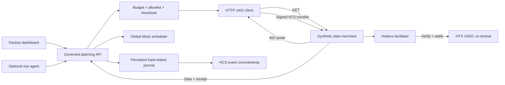

# GridAgent

**Intelligence that pays for itself.** A factory energy planner that discovers data services, compares prices, buys useful forecasts through x402, and schedules flexible industrial loads inside a spending policy. Payment and scheduling commitments can be anchored to Hedera Consensus Service.

Built for [ETHGlobal Mumbai 2026 — AI Agents That Pay: x402 on Hedera](https://ethglobal.com/events/mumbai/prizes/hedera).

> **Current evidence:** local end-to-end demo and automated tests pass. All forecast inputs are synthetic. Demo receipts are simulations with no Hedera transaction ID. Testnet integration is implemented but must be exercised with funded accounts before this qualifies as a real settled-payment submission. No legal compliance or production savings claim is made.

## Try it

[Public interactive demo](https://gridagent-mumbai-demo.vercel.app) · [Narrated walkthrough](docs/gridagent-demo.mp4) (2:21, 1280×720, audio, no music). The public site runs the optimizer and simulated payments entirely in your browser. Use the local Express service below for the actual HTTP 402 demonstration and configured Hedera testnet integration.

## Run locally

Node.js 24+ and npm are required.

```sh
npm ci
cp .env.example .env  # only if .env does not already exist; never overwrite existing keys
npm start
```

Open **http://localhost:4402** and click **Plan next shift**. No wallet, API key, or paid model is needed for the local demonstration. `npm run dev` enables reload. Factory constraints and spending controls are editable in the dashboard.

```sh
npm test
npm run build   # strict TypeScript validation; application runs via tsx
npm audit
```

The default scenario shifts 1,740 kWh across an air compressor, process cooling, and battery charging. The first run buys GridPulse prices (0.012 simulated USDC) and CarbonLens intensity (0.006), skips a redundant premium quote and weather without marginal value, and reduces modeled wholesale energy cost from €203.26 to €81.12. Carbon falls from 547.38 to 507.18 kg CO₂. These numbers describe one synthetic case, not a market prediction.

## What is autonomous?

The deterministic planner discovers the configured providers, chooses the lowest-price eligible useful feed in each category, enforces policy, completes a paid HTTP exchange, solves the schedule and writes its decision log. Data usefulness is a transparent heuristic: prices are useful; carbon is useful when weighted; weather is skipped because the fixed cooling load has no thermal model. It does not claim learned value-of-information or multi-agent negotiation.

An optional **eve language agent** can orchestrate the same governed service with typed tools. It never holds a separate payment path or bypasses budget enforcement. This model-backed path requires AI Gateway access and is not needed to run the deterministic demo:

```sh
cd agent
npm ci
# Configure AI_GATEWAY_API_KEY, GRID_SERVER_URL and GRID_API_TOKEN in this agent's environment as needed.
npm run typecheck
npm exec -- eve dev --no-ui
```

See [agent/agent/instructions.md](agent/agent/instructions.md). The initial scaffold's model is preserved. A successful typecheck is not evidence of a completed model turn.

## Architecture



The root service uses Express, Zod, TypeScript, `@hiero-ledger/sdk` and the official `@x402/hedera` client. The dashboard uses lightweight HTML/CSS/JavaScript and self-hosted open-source fonts. No Solidity contracts.

## Run as a container

The Node 24 container has been built and verified with a complete local paid-request planning run.

```sh
docker build -t gridagent .
docker run --rm -p 127.0.0.1:4402:4402 gridagent
```

This starts a disposable **demo**. For testnet, use one replica, inject secrets from a deployment secret store, and mount a persistent volume at `/app/data` writable by the container’s `node` user. The image intentionally contains no `.env` file or private keys. A Docker build is not evidence of a public deployment.

## Real Hedera testnet setup

1. Use project-only testnet accounts. Fund the payer and an independent merchant with testnet **USDC**, token `0.0.429274`, and associate the token to both accounts. The operator additionally needs testnet HBAR for HCS topic creation/messages. The x402 facilitator sponsors payment network fees.
2. Put secrets only in ignored `.env`, never in source or the browser:

   ```dotenv
   GRID_MODE=testnet
   HEDERA_ACCOUNT_ID=0.0.YOUR_PAYER
   HEDERA_PRIVATE_KEY=YOUR_DER_OR_SUPPORTED_SDK_KEY
   HEDERA_MERCHANT_ID=0.0.YOUR_MERCHANT
   HEDERA_USDC_TOKEN_ID=0.0.429274
   X402_FACILITATOR_URL=https://x402.org/facilitator
   GRID_API_TOKEN=LONG_RANDOM_OPERATOR_TOKEN
   ```

3. Run `npm run hedera:topic`; copy the returned topic ID into `HEDERA_TOPIC_ID`. The submit key is the operator key. The facilitator must advertise `hedera:testnet` and `extra.feePayer` from `/supported`.
4. Restart the server. Enter the operator token under Spending controls; click Plan next shift. Two eligible payments should occur without per-payment approval.
5. Verify a receipt through Hedera Mirror Node/HashScan, capture the real transaction ID in [docs/evidence.json](docs/evidence.json), and add the settled transaction link here. Verify HCS sequence/message hashes separately.

**Settled payment transaction ID: not yet available.** A generated-looking ID or a demo receipt does not satisfy the bounty.

Useful official references: [client](https://docs.hedera.com/solutions/ai/x402/pay-with-x402), [exact scheme](https://docs.hedera.com/solutions/ai/x402/exact-scheme), [facilitators](https://docs.hedera.com/solutions/ai/x402/facilitators).

## Payment protocol

`GET /.well-known/gridagent.json` discovers the providers. `GET /api/data/gridpulse` without authorization returns HTTP 402, a `PAYMENT-REQUIRED` header and x402 v2 requirements. In testnet these specify the USDC token, exact integer amount, allowlisted merchant and facilitator fee payer. The agent validates the quote, uses the official Hedera signer to construct a partially signed transfer, and retries with `PAYMENT-SIGNATURE`. The merchant verifies and settles through `/verify` and `/settle`, releasing data only on confirmed success. The response includes a receipt and `PAYMENT-RESPONSE` header.

Demo mode uses `demo:local` and `demo-USDC`, a process-local HMAC key, explicit `simulated: true` receipts and null transaction IDs. It demonstrates the HTTP flow without representing a real blockchain payment.

## Verify payment and HCS evidence

Use the read-only Mirror Node verifier after a real payment:

```sh
npm run verify:evidence -- payment TRANSACTION_ID PAYER_ID MERCHANT_ID 0.0.429274 12000
npm run verify:evidence -- hcs
```

Replace uppercase placeholders with actual IDs. The verifier checks successful parent consensus, exact HTS token amounts and counterparties, or the matching HCS commitment and sequence. It refuses local/demo events. It never pays, releases reservations, or writes success into the evidence file. See [verification and recovery](docs/VERIFICATION.md).

## Spending and integrity controls

- Limits use integer millionths of USDC. Effective daily/per-provider/automatic ceilings are the minimum of operator inputs and server environment limits.
- Budget is shared across runs for the Europe/Berlin calendar day and survives process restart.
- A reservation is written **before** requesting/signing a payment. Uncertain failures retain it. Reconcile before releasing uncertain amounts; do not automatically retry a possibly settled payment.
- Payment submissions have persistent, atomic replay claims after verification, including concurrent requests. Settlement receipts must match the transaction that was signed. Runs require an `Idempotency-Key`; repeating a successful run returns its original result without charging again.
- Testnet write APIs require a bearer operator token; cross-origin browser writes are refused. Never expose the operator token in public source.
- Data providers, recipient, network and token are configured server-side. The client cannot choose an arbitrary payee.
- Event bodies are SHA-256 linked. HCS messages commit event ID, type, run ID, hash and previous hash, with consensus sequence/transaction metadata stored locally. HCS failure never becomes a fake success.

The current JSON journal is for **one process on persistent disk**. It is not a distributed database or immutable storage: HCS anchors are what make previously published hashes externally checkable. Do not deploy real spending on an ephemeral serverless filesystem or multiple replicas. Keep public demo data separate from any real factory/customer data. Operator credentials grant control of testnet funds, so bind loopback or put authenticated TLS infrastructure in front of the service.

## Scheduling assumptions

Each load occupies one continuous hourly block within an earliest-start/finish-by window. The optimizer exhaustively searches with lower-bound pruning, limits peak concurrent kW, and minimizes wholesale energy cost plus a configurable EUR/tCO₂ carbon penalty. A two-million-node search guard rejects excessive problems rather than claiming an unproven optimum. Negative electricity prices are supported. Baseline capacity violations are reported.

There are 24 fixed slots, not a calendar-aware 23/25-hour day. Cooling is fixed; charging has no discharge/SOC model. There are no ramp rates, production precedence constraints, taxes, network tariffs or demand charges. Data cost in USDC and savings in EUR are reported separately. No physical dispatch. No certification or claim that HCS alone satisfies German energy audit law.

## Submission

See [submission copy](docs/SUBMISSION.md), [demo walkthrough](docs/DEMO.md), and [evidence](docs/evidence.json). Required outstanding items must be completed truthfully before marking the project submitted. The original repository is read-only for the current GitHub identity; work is published in the authorized project fork on `codex/gridagent`.
